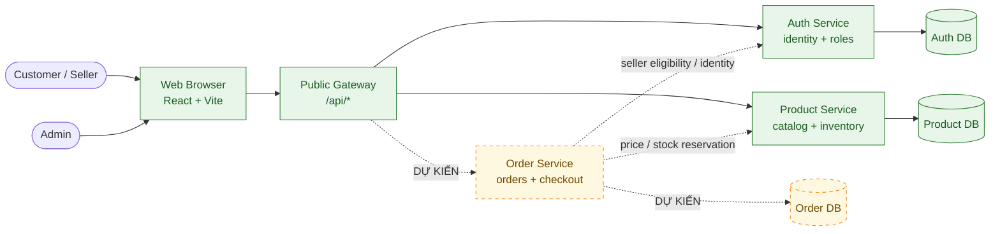
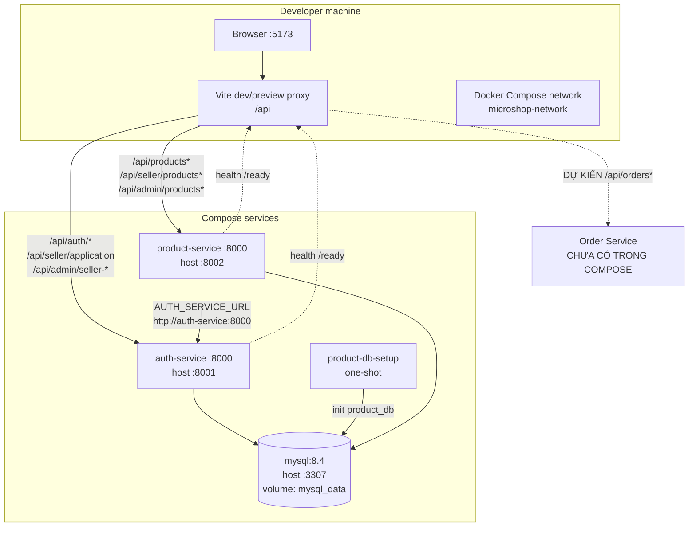
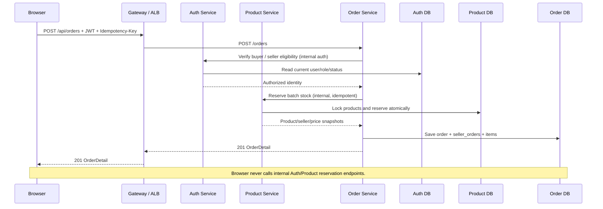
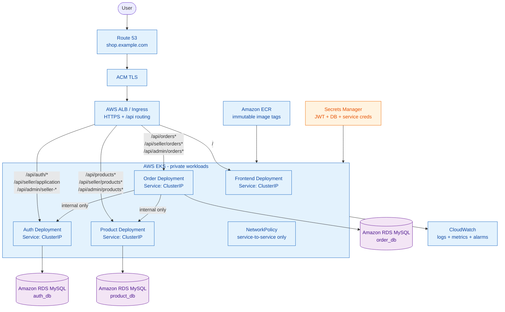

# MicroShop — Architecture Diagrams

Các diagram dưới đây mô tả kiến trúc tổng thể theo hai trạng thái:

- **Hiện tại:** frontend Vite gọi Auth/Product qua Vite proxy; Order chưa chạy.
- **Mục tiêu:** public gateway/ALB route `/api` tới Auth/Product/Order; service nội bộ phối hợp với database riêng logic.

Các đường nét đứt hoặc node có nhãn `DỰ KIẾN` chưa phải resource đang chạy. Chi tiết triển khai: [Deployment Architecture](DEPLOYMENT_ARCHITECTURE.md). Chi tiết URL gateway: [Gateway Routing](GATEWAY_ROUTING.md).

## 1. System context



**Ownership:** Auth owns users/roles/seller application; Product owns products and stock; Order owns orders, seller orders and item snapshots. No service reads another service's database directly.

## 2. Local runtime hiện tại



Hiện frontend chạy ngoài Compose; chỉ Auth/Product/MySQL đang có container. `product-db-setup` chỉ khởi tạo database, không phải service xử lý request.

## 3. Public request flow mục tiêu



Nếu bước ghi Order DB thất bại sau khi reserve, Order release/reconcile **cùng reservation key**. Không tạo reservation mới khi timeout chưa rõ kết quả.

## 4. Kubernetes/AWS target



### Target deployment boundaries

- ALB là public entrypoint duy nhất; service dùng `ClusterIP`, không public NodePort.
- RDS nằm ngoài EKS workload; pod không chạy MySQL production.
- ECR chứa image theo git SHA; không dùng `latest` production.
- Secrets Manager cấp secret runtime; không đưa secret vào image, Git hoặc frontend bundle.
- `/internal/*` không có Ingress route; chỉ Order gọi Auth/Product bằng service credential.
- Frontend giữ cùng URL `/api` ở local, staging và production; chỉ thay proxy/gateway target.

## 5. CI/CD flow

```mermaid
flowchart LR
    PR["Pull Request"] --> Tests["Backend tests\nFrontend build/E2E"]
    Tests --> Build["Build + scan images"]
    Build --> ECR["Push ECR\ngit SHA tag"]
    ECR --> Staging["Deploy staging\nKubernetes overlay"]
    Staging --> Smoke["Smoke test\nhealth/readiness + /api"]
    Smoke --> Approval{ "Manual approval" }
    Approval -->|"approved"| Prod["Deploy production\nrolling update"]
    Approval -->|"rejected"| Stop["Stop / fix"]
    Prod --> Monitor["CloudWatch\nalerts + rollback"]
```

Migration database là release step có kiểm soát, không chạy ngầm trong mỗi pod startup. Rollback image dùng git SHA trước đó; schema migration phải backward-compatible.

## 6. Diagram legend

| Ký hiệu | Ý nghĩa |
|---|---|
| Mũi tên liền | Luồng đang có hoặc luồng runtime chính |
| Mũi tên nét đứt | Luồng dự kiến/internal cần triển khai |
| Node vàng | Thành phần chưa chạy hoặc cần chốt thêm |
| Node xanh | Thành phần hiện có/đã chốt trong kiến trúc |
| Gateway/ALB | Public routing, không thay thế authorization |
| Database | Chỉ service sở hữu được đọc/ghi trực tiếp |

## 7. Review checklist

- [ ] Diagram local khớp `docker-compose.yml` và `frontend/vite.config.ts`.
- [ ] Order chỉ được chuyển từ nét đứt sang runtime sau khi issue #4/#5 và dependencies hoàn thành.
- [ ] Public route giữ `/api`; internal reservation không xuất hiện trong gateway.
- [ ] Mỗi service có database ownership rõ ràng, không dùng cross-database foreign key.
- [ ] Kubernetes dùng readiness/liveness, resource limits, Secret reference và ClusterIP.
- [ ] AWS dùng private RDS, ECR immutable tags, ALB TLS và logging.
- [ ] Cập nhật diagram trong cùng PR khi thêm service, route hoặc thay đổi deployment boundary.

## 8. Tài liệu liên quan

- [Deployment Architecture](DEPLOYMENT_ARCHITECTURE.md)
- [Gateway Routing](GATEWAY_ROUTING.md)
- [API Contract](API_CONTRACT.md)
- [Frontend Routes](FRONTEND_ROUTES.md)
- [Infrastructure structure](../infrastructure/README.md)
- [Deployment structure](../deploy/README.md)
